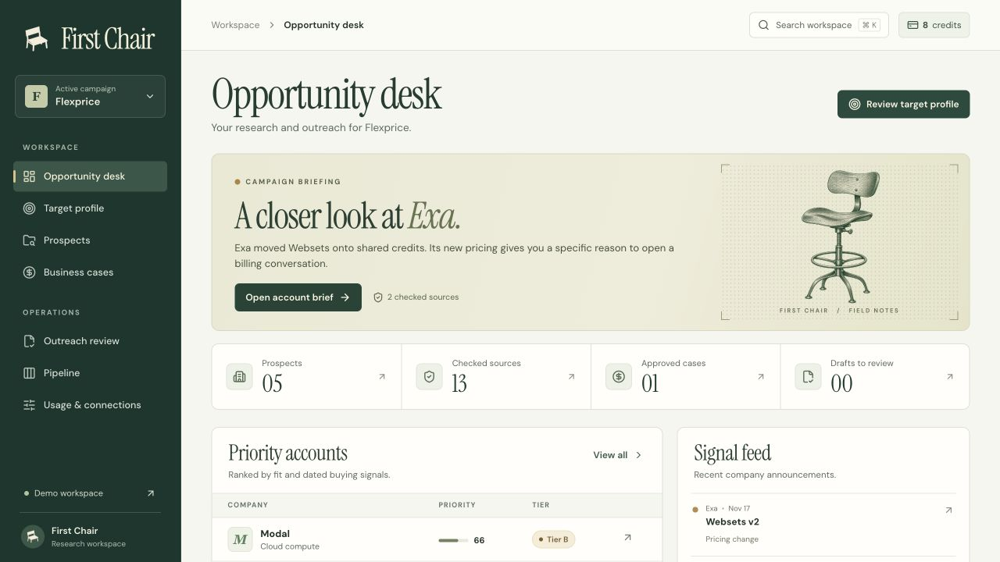

# First Chair

First Chair helps a founder decide who to approach, why now, and whether the deal makes financial sense for the buyer. The reference campaign applies that workflow to Flexprice and five developer-tool and AI infrastructure companies.

**[Open the interactive judge demo](https://first-chair-deal-desk.citrus-rice-6108.chatgpt.site/#demo)** · [Watch the two-minute recording](demo/walkthrough.mp4) · [Read the product brief](PRD.md)

## Try the demo

1. Open **Opportunity desk** and select **Open account brief**. Exa recently moved Websets onto shared credits. Its account includes the original announcement and the exact excerpt.
2. Open **Business case**. Four assumed build months and a 20% maintenance allocation model an $84,000 internal build. A $500 monthly subscription, 0.40% of $1 million billed, and half an engineer-month of integration model a $17,500 purchase. The $66,500 difference includes the value of staff time. The default cash impact is negative $10,000. The buyer's actual budget and implementation costs still need confirmation.
3. Choose **Edit assumptions** and change build effort from four months to two. The base advantage falls to $42,500 immediately. All three scenarios recalculate. Restore four or keep your estimate, then approve the case.
4. Choose **Prepare outreach**, approve the exact message, and edit one character. Dispatch becomes available again only after another approval. A rehearsal dispatch creates a local outbox entry and moves the account to Contacted.
5. Open **Usage & connections** for the ledger and reviewer decisions. Contact checks cost two credits. A relationship query, business case approval, or approved dispatch costs one. A zero balance blocks the action. The rehearsal starts with ten credits and can be reset.

The reference workspace includes 13 checked excerpts across Exa, Firecrawl, Modal, Browserbase, and Tavily. The scoring snapshot is dated November 24, 2026. The hosted demo runs the real financial and approval rules in the browser with a local rehearsal outbox and usage ledger.

### Reference fit benchmark

[Twenty source-linked labels](data/fit-benchmark.json) apply a single rubric. Companies qualify when they sell developer-facing software or AI infrastructure and publish a consumption-based unit or credit model. The curated reference shortlist scores **5/5 for fit**, and 16/20 companies in the comparison set qualify. This is a single-reviewer benchmark of a curated shortlist. Live discovery quality and buying intent need separate evaluation. The pipeline also lets operators enter their own judgments and compute campaign Precision@5.

[Flexprice pricing](https://flexprice.io/pricing) · [Exa’s Websets announcement](https://exa.ai/blog/websets-v2)

## Run it

Install Node.js 22 or later and Python 3.11 or later. Run the following from the repository root.

~~~sh
npm ci
npm run dev
~~~

Open the address printed by Next.js. This browser prototype saves its state locally. A production static build is generated by npm run build in the out directory.

For the persistent MVP, serve the API and built interface together.

~~~sh
npm run build
python3 -m venv .venv
. .venv/bin/activate
pip install -r requirements.txt
python -m uvicorn backend.app:app --host 127.0.0.1 --port 8400
~~~

Open [the local MVP](http://127.0.0.1:8400). The default server uses a local SQLite database in .local. The Dockerfile packages the same frontend and API. Mount a volume at /var/lib/firstchair when using the container.

## What runs where

| Component | Rehearsal | Connected operator workspace |
| --- | --- | --- |
| Target profile and discovery | Editable profile and five source-checked accounts | Anthropic infers the profile. Tavily retrieves candidates and independently re-fetches cited pages |
| Account priority | Deterministic fit, intent decay, source quality, tier | Same calculation, applied to new evidence |
| Relationship paths | Local graph uses documented billing vendors, work history, and operator-confirmed reference customers | Neo4j executes scoped, multi-hop warm-introduction and displacement queries |
| Financial case | Editable provenance, three scenarios, cash and released capacity | Same deterministic calculation |
| Outreach | Local writer and reviewer, exact-copy approval, demo outbox | Five Band identities exchange a job in one room. Gmail can deliver only to the configured team test inbox |
| Usage | Local credit balance and four event types | Checks Flexprice entitlements and wallet before work. A durable event queue retries successful usage records |
| Pipeline | Manual stages, outcomes and ranking labels | Changes persist in the operator database |

## Connect sponsor services

The app defaults to rehearsal. To run live, copy .env.example to .env locally, fill in the services you intend to exercise, and load the variables into both processes. Real secrets belong only on the server. The example ships with empty values.

~~~sh
set -a
. ./.env
set +a
python -m uvicorn backend.app:app --host 127.0.0.1 --port 8400
~~~

Set FIRSTCHAIR_MODE to live and set FIRSTCHAIR_OPERATOR_TOKEN. Open **Usage & connections → Connections → Connect operator**, then enter that token. The live database starts with a product brief awaiting review. The campaign credit cap is separate from the actual provider wallet balance.

- **Band.** Register five distinct agent identities for Planner, Researcher, Analyst, Writer, and Reviewer. Add them and the human operator to the configured room. Set the role keys, IDs, room ID, human participant ID, and a separate shared worker token. In a second terminal with the same environment, run npm run band. A draft request starts the job. Researcher rechecks excerpts, Analyst computes an approved case, Writer proposes wording, and Reviewer returns unsupported buying-intent claims for revision before handing the draft to a human.
- **Flexprice.** Supply a customer external ID, an active wallet ID, and API key. Set four feature lookup keys and meter event names to lead_enriched, graph_query, business_case_generated, and outreach_sent. Configure prices of 2, 1, 1, and 1 credit per event respectively. The matching active entitlements and wallet must allow the operation. The local operation ID becomes the Flexprice event ID. An operator can retry queued events through POST /api/meter/retry.
- **Research.** Set TAVILY_API_KEY, ANTHROPIC_API_KEY, and a model ID available to your Anthropic account. The search funnel selects up to five companies and verifies exact text on a second extraction before admitting a claim.
- **Neo4j, Hunter and Gmail.** Connect Neo4j for live path checks and Hunter for contact discovery and verification. For Gmail, configure OAuth credentials with gmail.send permission and an explicitly controlled test inbox. Outreach to individual prospect addresses is outside the demo flow. Ambiguous Gmail responses block a repeat send until the operator checks the test inbox.

Provider adapters are implemented. The test suite exercises local handoffs, approval boundaries, and metering failure handling. Live sponsor receipts, real room handoffs, and email delivery require team credentials. In the public walkthrough, the zero-credit exercise runs the same local guard against an isolated rehearsal balance.

[Band agent messages](https://docs.band.ai/api/agent-api/agent-api-messages) · [Flexprice](https://docs.flexprice.io/) · [Tavily](https://docs.tavily.com/) · [Hunter](https://hunter.io/api-documentation/v2)

## Architecture and checks

The Next.js interface uses a shared JavaScript state machine for scoring, finance, approval, and credit rules. In server mode FastAPI applies those same rules to authoritative SQLite state. A workspace revision prevents stale writes. Each operation has an idempotency key. An approval binds the channel, account, recipient, subject, and body using SHA-256. Successful dispatches are immutable. A durable send reservation prevents an ambiguous provider result from causing a second email.

| Route | Use |
| --- | --- |
| GET /api/status | Mode and configured service names |
| GET /api/workspace | Read the active workspace |
| POST /api/actions | Apply a versioned operation with an idempotency key |
| GET /api/jobs/{id} | Progress or result of an asynchronous Band draft |
| POST /api/band/turn | Authenticated worker handoff |
| POST /api/meter/retry | Retry pending meter events |
| GET /docs | Interactive API reference on the FastAPI service |

~~~sh
npm test
pip install httpx
python -m unittest discover -s tests -p 'test_*.py'
python scripts/verify_sources.py
npm run build
~~~

Each updated source record should retain the original URL, exact quote, publication date if available, confirmation timestamp, and evidence type. Both financial and credit arithmetic run in code. The original PRD remains in the repository for the team.
